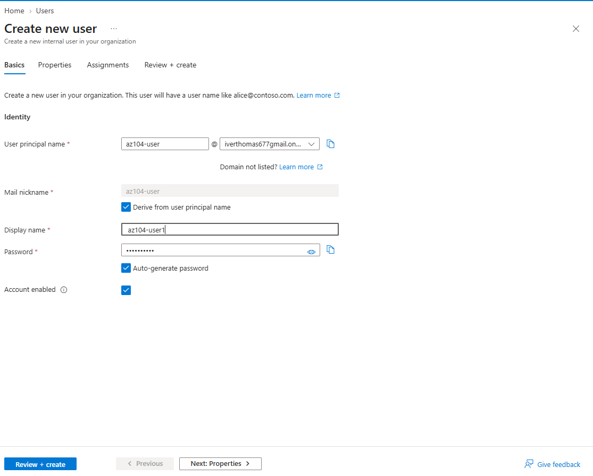
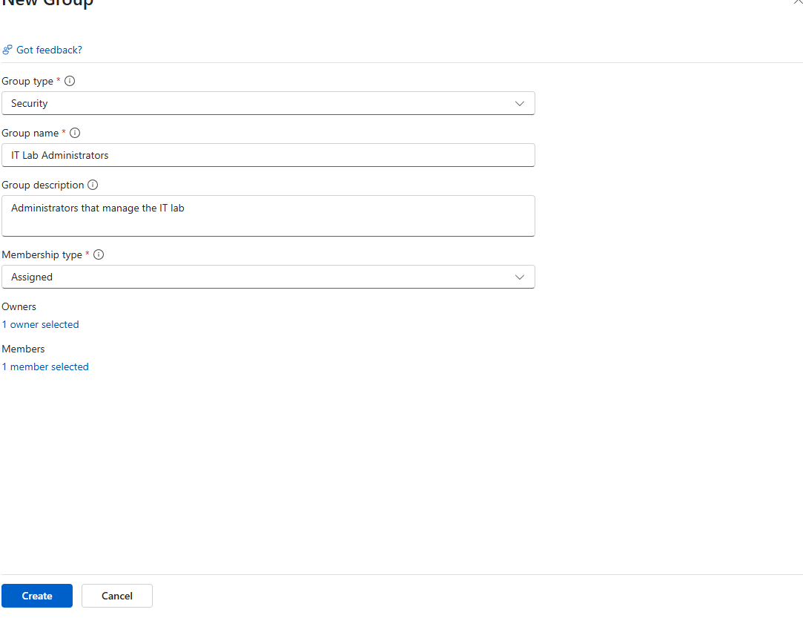
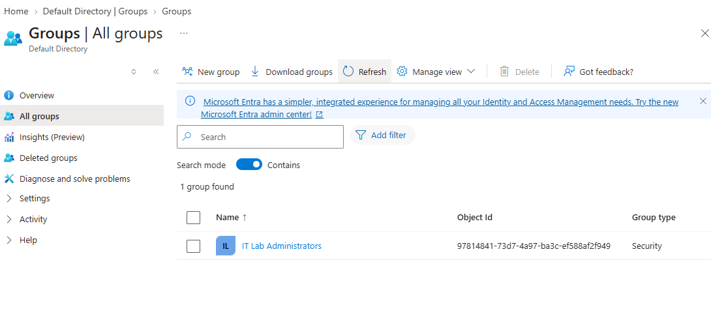

# Lab 01 — Manage Microsoft Entra ID Identities

Part of the [AZ-104 Lab Portfolio](../) — Microsoft Azure Administrator hands-on labs.

## Scenario
Provision users and groups in Microsoft Entra ID so new engineers can authenticate into
a pre-production lab environment, with group membership that minimizes admin overhead.

## What I did
- Created a new Entra ID user (`az104-user1`) with job title, department, and usage
  location configured on the Properties tab.
- Invited an external guest user (Microsoft Entra B2B collaboration).
- Created a Security group ("IT Lab Administrators," assigned membership) and added
  an owner and both users as members.

## Screenshots
| | |
|---|---|
|  | Creating `az104-user1` |
|  | Configuring the security group |
|  | Group live in Entra ID |

## Skills demonstrated
Entra ID identity management · group-based access provisioning · B2B guest collaboration
