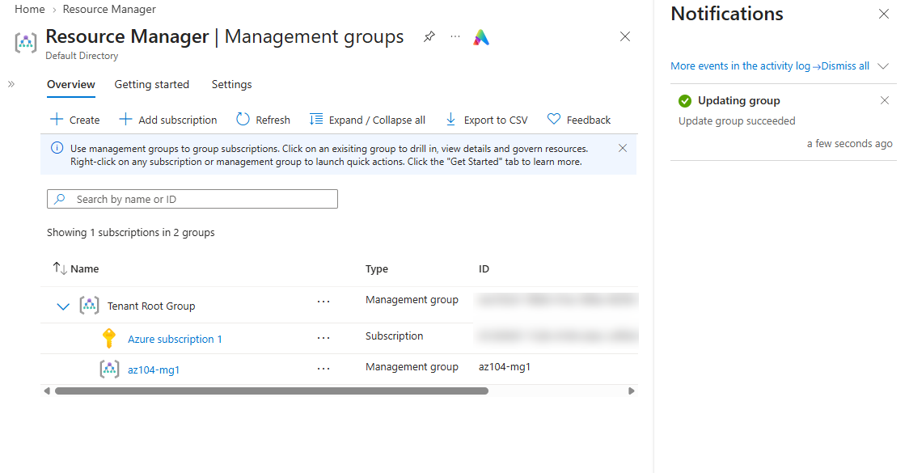
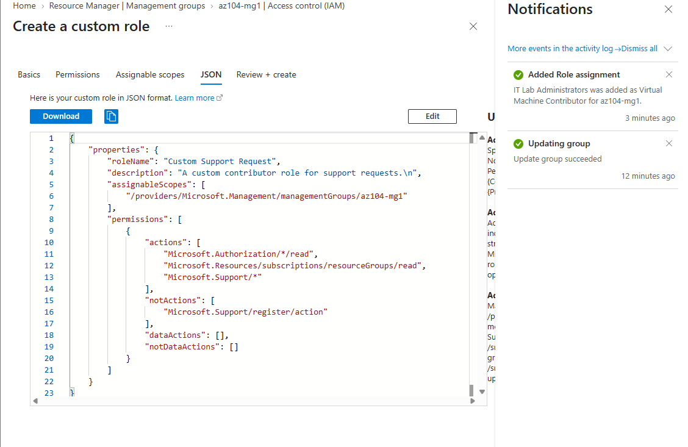
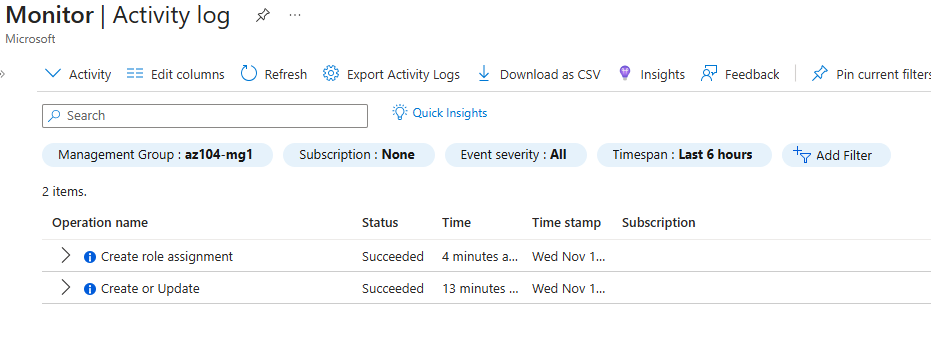

# Lab 02a — Manage Subscriptions and RBAC

Part of the [AZ-104 Lab Portfolio](../) — Microsoft Azure Administrator hands-on labs.

## Scenario
Simplify access management across subscriptions: create a management group, then give a
support team exactly the permissions it needs at that scope — manage virtual machines and
open support tickets, nothing more.

## What I did
- Created the management group `az104-mg1` under the Tenant Root Group.
- Assigned the built-in **Virtual Machine Contributor** role to the IT Lab Administrators
  group at the management group scope, so access flows down to every subscription in it.
- Wrote a custom RBAC role, **Custom Support Request**, scoped to `az104-mg1`:
  read access to authorization and resource groups, full access to `Microsoft.Support/*`,
  and `Microsoft.Support/register/action` explicitly excluded via `notActions`.
  Definition: [`custom-support-request-role.json`](./custom-support-request-role.json)
- Verified the role assignment and management group changes in the Activity Log.

## Screenshots
| | |
|---|---|
|  | `az104-mg1` created in the management group hierarchy |
|  | Custom role definition, plus the VM Contributor assignment confirmation |
|  | Role assignment and group update recorded in the Activity Log |

## Skills demonstrated
Management groups · built-in vs. custom RBAC roles · least-privilege scoping with `actions`/`notActions` · auditing with the Activity Log
