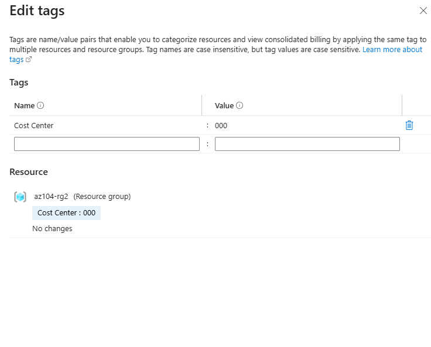
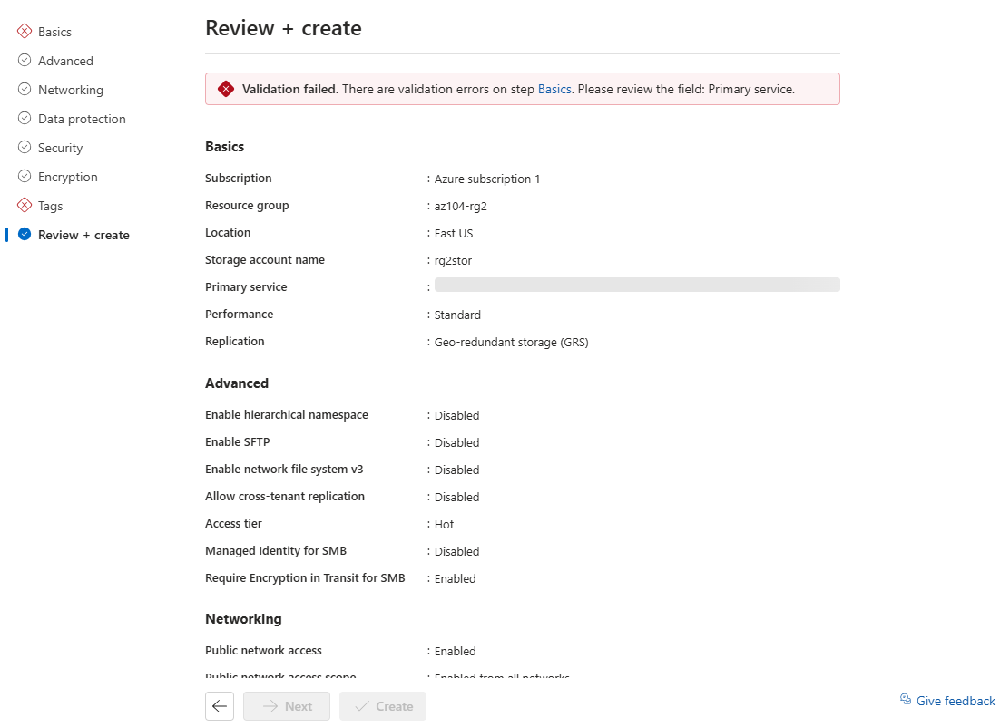
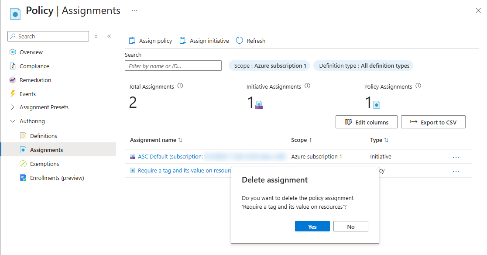
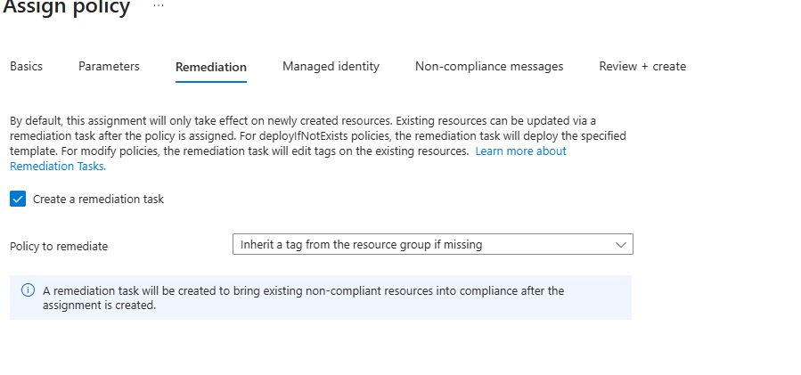
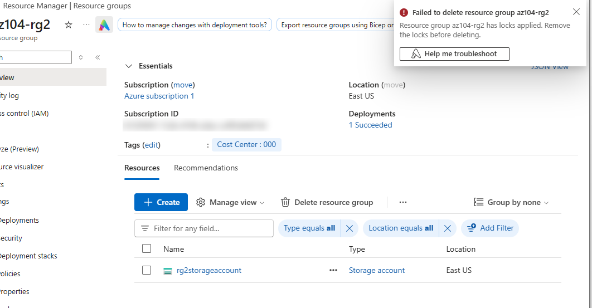

# Lab 02b — Manage Governance via Azure Policy

Part of the [AZ-104 Lab Portfolio](../) — Microsoft Azure Administrator hands-on labs.

## Scenario
An audit found many Azure resources with no owner, project, or cost center. Fix it going
forward and backward: tag resources, enforce tagging on new ones, backfill tags on existing
ones automatically, and protect configured resources from accidental deletion.

## What I did
- Tagged the resource group `az104-rg2` with `Cost Center : 000`.
- Assigned the built-in policy **Require a tag and its value on resources** to the
  subscription, then attempted to create a storage account without the tag — validation
  failed and the deployment was blocked.
- Removed that assignment and replaced it with **Inherit a tag from the resource group if
  missing**, including a **remediation task** so existing non-compliant resources get the
  tag too — not just new ones.
- Applied a resource lock to `az104-rg2` and tried to delete the resource group — Azure
  refused: *"Resource group az104-rg2 has locks applied. Remove the locks before deleting."*

## Screenshots
| | |
|---|---|
|  | `Cost Center : 000` applied to `az104-rg2` |
|  | Storage account creation fails validation with the tag missing |
|  | The require-tag assignment, removed before switching to the inherit-tag policy |
|  | Inherit-tag policy with a remediation task for existing resources |
|  | Resource lock blocking deletion of the resource group |

## Skills demonstrated
Azure Policy assignment · deny vs. modify effects · remediation tasks · resource tagging for cost tracking · resource locks
