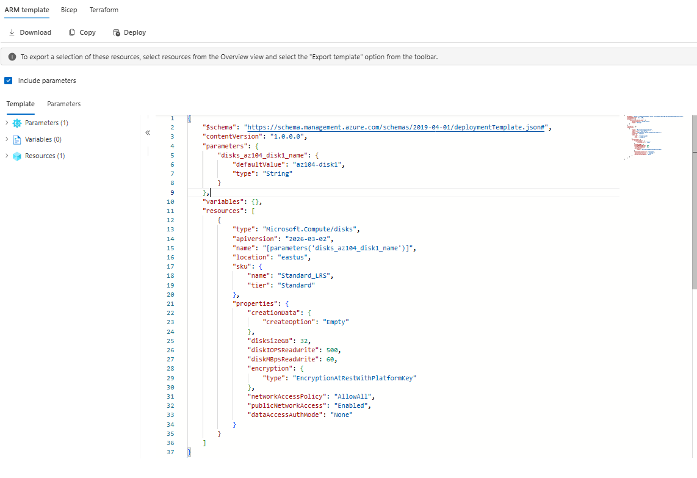
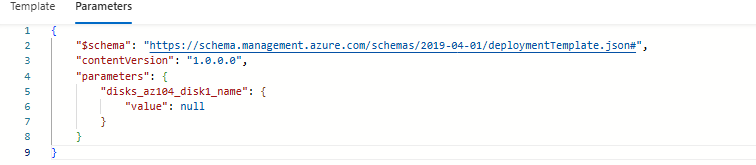
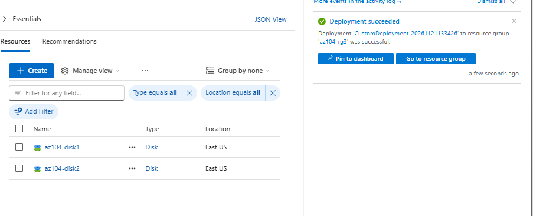
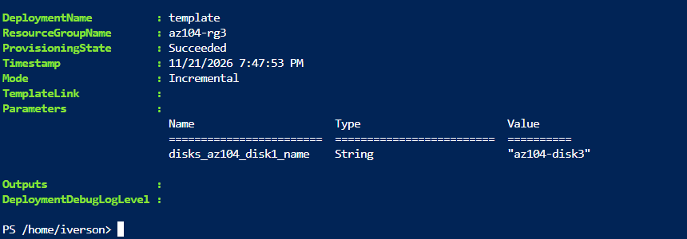
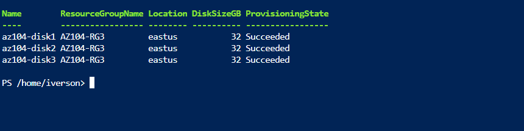
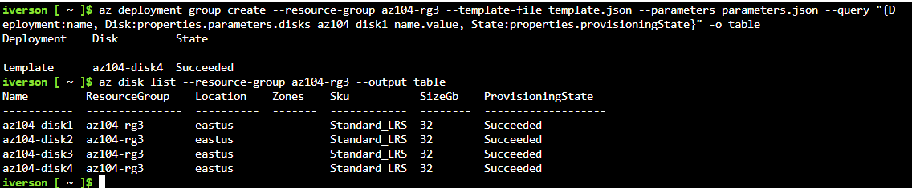
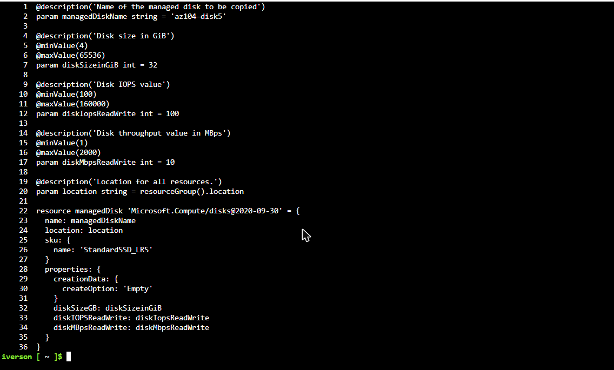
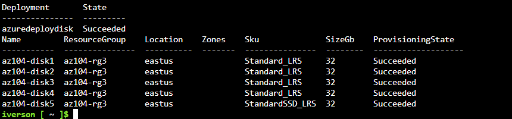

# Lab 03 — Manage Azure Resources with ARM Templates and Bicep

Part of the [AZ-104 Lab Portfolio](../) — Microsoft Azure Administrator hands-on labs.

## Scenario
Standardize and automate resource deployment. Deploy the same kind of resource — a managed
disk — five different ways, moving from clicking in the portal to fully declarative code.

## Five disks, five methods

| Disk | Method | How |
|---|---|---|
| `az104-disk1` | Azure portal | Created manually, then **exported as an ARM template** |
| `az104-disk2` | Portal custom deployment | Edited the exported template and redeployed it |
| `az104-disk3` | Azure PowerShell | `New-AzResourceGroupDeployment -ResourceGroupName az104-rg3 -TemplateFile template.json -TemplateParameterFile parameters.json` |
| `az104-disk4` | Azure CLI (Bash) | `az deployment group create --resource-group az104-rg3 --template-file template.json --parameters parameters.json` |
| `az104-disk5` | Bicep | `az deployment group create --resource-group az104-rg3 --template-file azuredeploydisk.bicep` |

For disks 3 and 4 the only change was the disk name parameter's default value. For disk 5 I
edited the Bicep file: name `az104-disk5`, size 32 GiB, and SKU changed from `UltraSSD_LRS` to
`StandardSSD_LRS`.

## Files
- [`template.json`](./template.json) — ARM template exported from `az104-disk1`
- [`parameters.json`](./parameters.json) — its exported parameters file
- [`azuredeploydisk.bicep`](./azuredeploydisk.bicep) — the Bicep file as deployed for disk 5

## Screenshots
| | |
|---|---|
|  | ARM template exported from disk 1 |
|  | Its parameters file |
|  | Edited template redeployed as disk 2 |
|  | Disk 3 deployed with PowerShell — Succeeded |
|  | `Get-AzDisk` confirming disks 1–3 |
|  | Disk 4 deployed with the Azure CLI, confirmed with `az disk list` |
|  | The edited Bicep file |
|  | Disk 5 deployed from Bicep — all five disks Succeeded |

## Skills demonstrated
ARM template export and editing · template parameters · Azure PowerShell · Azure CLI · Bicep · Cloud Shell
