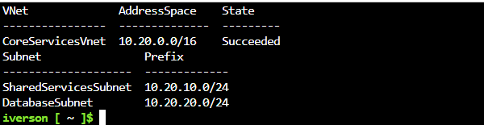
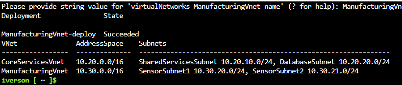
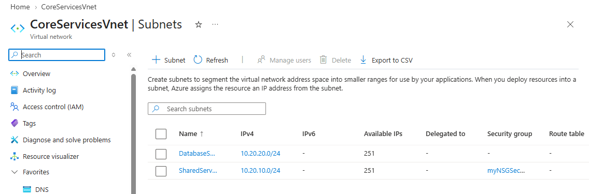
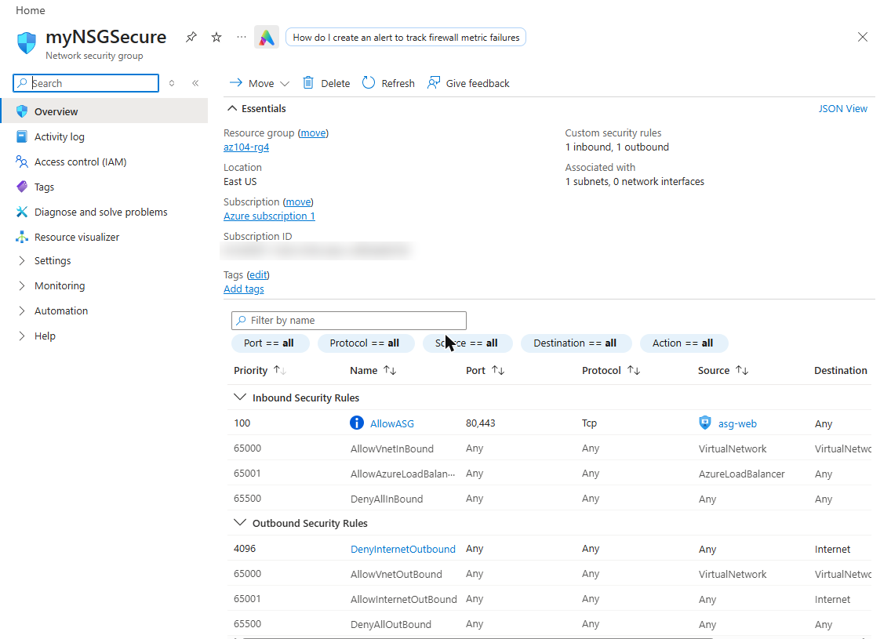
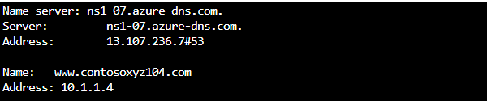
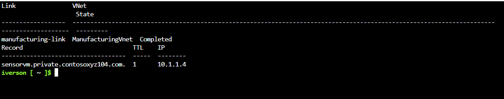
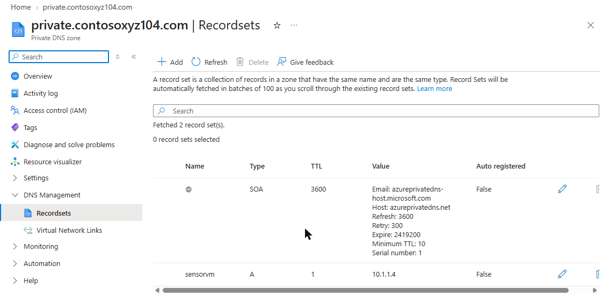

# Lab 04 — Implement Virtual Networking

Part of the [AZ-104 Lab Portfolio](../) — Microsoft Azure Administrator hands-on labs.

## Scenario
A growing organization needs virtual networks with room to scale: a large `CoreServicesVnet`
for shared services and databases, and a `ManufacturingVnet` for a growing number of
connected sensor devices. Traffic needs to be controlled, and names need to resolve both
publicly and privately.

## Address plan

| VNet | Address space | Subnets |
|---|---|---|
| CoreServicesVnet | 10.20.0.0/16 | SharedServicesSubnet 10.20.10.0/24 · DatabaseSubnet 10.20.20.0/24 |
| ManufacturingVnet | 10.30.0.0/16 | SensorSubnet1 10.30.20.0/24 · SensorSubnet2 10.30.21.0/24 |

Non-overlapping ranges, so the two networks can be peered later (Lab 05).

## What I did
All tasks run from Azure Cloud Shell (Bash) with the Azure CLI; results verified in the portal.

**Task 1 — VNet with subnets.** Created `az104-rg4`, `CoreServicesVnet`, and both subnets.

**Task 2 — VNet from a template.** Exported the CoreServicesVnet ARM template with
`az group export`, used `sed` to swap names and address ranges (CoreServicesVnet → ManufacturingVnet,
10.20 → 10.30, subnets → SensorSubnet1/2), and deployed it with `az deployment group create`.
Template: [`manufacturingvnet-template.json`](./manufacturingvnet-template.json)

**Task 3 — ASG + NSG.** Created the application security group `asg-web` and the network
security group `myNSGSecure`, associated the NSG with `SharedServicesSubnet`, and added:

| Rule | Direction | Priority | Source | Ports | Action |
|---|---|---|---|---|---|
| AllowASG | Inbound | 100 | asg-web | TCP 80, 443 | Allow |
| DenyInternetOutbound | Outbound | 4096 | Any → `Internet` service tag | Any | Deny |

The ASG lets the rule target “web servers” as a group instead of a list of IP addresses.

**Task 4 — DNS.**
- Public zone `contosoxyz104.com` with an A record `www → 10.1.1.4`; verified with
  `nslookup www.contosoxyz104.com` against the zone's Azure name server.
- Private zone `private.contosoxyz104.com`, linked to ManufacturingVnet (`manufacturing-link`),
  with an A record `sensorvm → 10.1.1.4`. Private zones resolve only inside linked VNets.

## Screenshots
| | |
|---|---|
|  | CoreServicesVnet and its subnets created |
|  | ManufacturingVnet deployed from the edited template — both VNets listed |
|  | Subnets in the portal; SharedServicesSubnet associated with myNSGSecure |
|  | AllowASG (inbound from asg-web) and DenyInternetOutbound rules |
|  | Public DNS: www.contosoxyz104.com resolves to 10.1.1.4 |
|  | Private zone linked to ManufacturingVnet, sensorvm record |
|  | Private zone record sets in the portal |

## Skills demonstrated
VNet and subnet design · CIDR planning · ARM template export/reuse · NSGs and ASGs · service tags · Azure public and private DNS · Azure CLI
