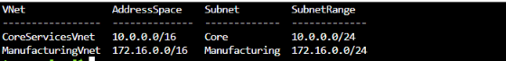
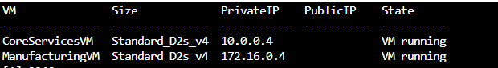
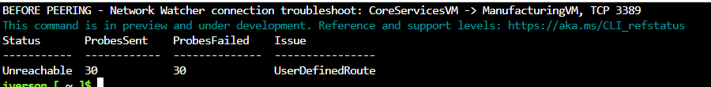
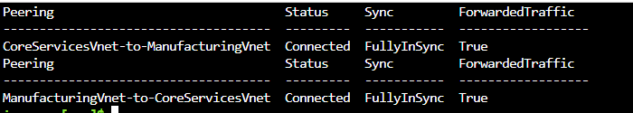
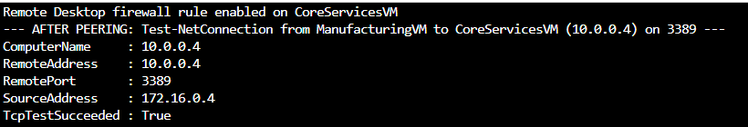
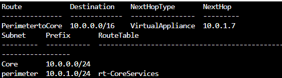

# Lab 05 — Implement Intersite Connectivity

Part of the [AZ-104 Lab Portfolio](../) — Microsoft Azure Administrator hands-on labs.

## Scenario
Core services and manufacturing workloads live in separate virtual networks. Prove they
can't talk by default, connect them with VNet peering, verify the fix, then add a custom
route so perimeter traffic is forced through a future network virtual appliance (NVA).

## Environment

| VNet | Address space | Subnet | VM | Private IP |
|---|---|---|---|---|
| CoreServicesVnet | 10.0.0.0/16 | Core 10.0.0.0/24 | CoreServicesVM | 10.0.0.4 |
| ManufacturingVnet | 172.16.0.0/16 | Manufacturing 172.16.0.0/24 | ManufacturingVM | 172.16.0.4 |

Both VMs: Windows Server 2025 Datacenter, no public IP, no inbound ports open.

## What I did
All tasks run from Azure Cloud Shell (Bash) with the Azure CLI.

1. **VNets and VMs.** Created both VNets and Windows Server VMs. The lab's VM size
   (`Standard_D2s_v3`) was unavailable in East US due to capacity restrictions, so I
   scripted a fallback through several sizes; both VMs deployed as `Standard_D2s_v4`.
2. **Before peering — Network Watcher.** Ran a connection troubleshoot from CoreServicesVM to
   ManufacturingVM on TCP 3389: **Unreachable, 30 of 30 probes failed** — separate VNets have
   no route to each other by default.
3. **VNet peering.** Created `CoreServicesVnet-to-ManufacturingVnet` and
   `ManufacturingVnet-to-CoreServicesVnet` with VNet access and forwarded traffic allowed.
   Both show **Connected / FullyInSync**.
4. **After peering — Test-NetConnection.** Used VM Run Command to enable the Remote Desktop
   firewall rule on CoreServicesVM, then ran `Test-NetConnection 10.0.0.4 -Port 3389` from
   ManufacturingVM: **TcpTestSucceeded : True** (172.16.0.4 → 10.0.0.4).
5. **Custom route.** Added a `perimeter` subnet (10.0.1.0/24), created route table
   `rt-CoreServices` (gateway route propagation off) with route `PerimetertoCore`:
   10.0.0.0/16 → next hop **Virtual appliance 10.0.1.7**, and associated it with the
   perimeter subnet.
6. **Cleanup.** Deleted the resource group afterward so the VMs stopped billing.

## Screenshots
| | |
|---|---|
|  | Both VNets with non-overlapping address spaces |
|  | Both VMs running, private IPs only |
|  | Network Watcher before peering: Unreachable |
|  | Peering connected in both directions |
|  | Test-NetConnection after peering: TcpTestSucceeded True |
|  | User-defined route to the NVA, associated with the perimeter subnet |

## Skills demonstrated
VNet peering · Network Watcher connection troubleshoot · VM Run Command · user-defined routes and route tables · working around regional capacity limits · Azure CLI scripting
